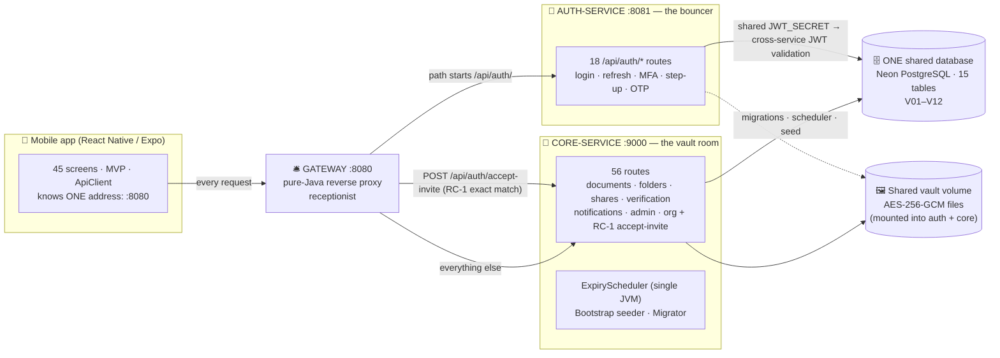

# DocuTrust — Architecture (Microservices Refactor)



Rendered diagram: [`diagrams/architecture.png`](diagrams/architecture.png) · Mermaid source: [`diagrams/src/architecture.mmd`](diagrams/src/architecture.mmd)

> **Plain English — why it looks like this:** the first submission was a *modular monolith* — one building where every room could shout to every other room, which was the right call for six students with real transactions. Then the app grew, and we moved to a **campus of three buildings** using the **Strangler Fig** pattern: a new fig (the gateway) grows around the old tree (the monolith, now core-service) and takes over its entrances one branch at a time, without ever cutting the tree down mid-growth. Auth was extracted **first** because it is the smallest, cleanest branch; the mobile app kept pointing at one address (8080) the entire time, so users never noticed the construction site. The rule of the house is still "boring and readable beats clever": a hand-written proxy you can read in ten minutes, one middleware chain per service, and a database schema that enforces the invariants even when application code has a bug.

> **Explain the Strangler Fig like I'm 5:** imagine a big old tree that is the whole restaurant. Instead of knocking it down while customers are eating (terrible idea), you build a **small front desk** in front of it (the gateway), and then build **new kitchen huts** one at a time, each time telling the front desk: "burger orders go to the new hut now." Customers still walk up to the same desk and say the same words. When every hut is built, the old tree can quietly retire. We have built the desk and the first hut (auth); the vault room is still the old tree's best room, and the next huts (vault-service, admin-service — the two stubs already sitting in `server/`) will take over later branches.

## For absolute beginners: the campus and the smartphone

**The backend is a campus with three buildings and one shared pantry.** The **receptionist** (`gateway`, port 8080) is the only door customers use: it checks nothing except *where* your request should go, forwards it **unchanged** (method, address, query string, headers, body — byte for byte), and carries the answer back. If the building it needs is closed, it hands back a polite `502 BAD_GATEWAY` note instead of pretending. The **bouncer** (`auth-service`, 8081) owns proving who you are: passwords, the ID cards called JWTs, the emailed one-time codes. The **vault room** (`core-service`, 9000) owns everything valuable: encrypted documents, share links, verification proofs, admin paperwork. Both working buildings reach into the **same pantry** (one Neon PostgreSQL database, 15 tables) and the **same safe** (one AES-256-GCM vault volume, mounted into both) — and because the bouncer prints ID cards **with the same secret ink** the vault room uses to check them (`JWT_SECRET` shared via `.env`), a card printed at one building is trusted at the other with no phone call. That is cross-service JWT validation, and it is why "log in, then list my documents" works across two JVMs.

**The frontend is still a smartphone** — and deliberately unchanged. `screens/` are the apps you open (45 of them); `components/` are the buttons; `microservices/` are the invisible background processes that fetch your data; `navigation/` is the home-screen gesture; `core/config/env.js` reads `EXPO_PUBLIC_API_URL`, which now points at the **gateway** (`:8080`). The phone cannot tell there are two buildings behind the desk — that is the Strangler Fig paying off. The full beginner walkthroughs live in [`DEFENCE_GUIDE.md`](../DEFENCE_GUIDE.md) Part 2.

## The gateway routing rules (all of them)

| # | Rule | Goes to | Why |
|---|---|---|---|
| 1 | `POST` **exactly** `/api/auth/accept-invite` | **core-service** (9000) | **RC-1:** the handler is `OrgController.acceptInvite` — admin-domain organisation logic that happens to live under the `/api/auth/` prefix. The exact-match rule is checked *before* the prefix rule |
| 2 | Path starts with `/api/auth/` | **auth-service** (8081) | Everything identity-shaped lives with the bouncer |
| 3 | Everything else | **core-service** (9000) | Documents, folders, shares, verification, notifications, admin, org, health |

**What the gateway forwards untouched:** HTTP method, raw path, raw query string (encoded `%XX` stays byte-identical), body read as bytes (so 25 MB document uploads survive), and every header except the ones a proxy must never copy: hop-by-hop headers (`connection`, `keep-alive`, `transfer-encoding`, `upgrade`, `te`, `trailer`, `proxy-*`), `host` and `content-length` (recomputed for the new destination), and `date`/`server` (stamped by the receiving server). It **recomputes `X-Forwarded-For`** from the real client address so the append-only audit trail keeps recording the true client IP instead of the gateway's loopback. Responses come back with their exact status code and headers (CORS, `X-Dev-OTP`, multi-`Set-Cookie` all pass through); `204`/`304` stay body-less. If the upstream is unreachable, the gateway itself answers **502** `{"ok":false,"error":{"code":"BAD_GATEWAY",…}}`. Implementation: pure JDK 21 (`com.sun.net.httpserver.HttpServer` + `java.net.http.HttpClient`, HTTP/1.1, 5 s connect / 60 s request timeout, 64 worker threads) — no Spring, no Jetty, zero new dependencies.

## Layers

```
Mobile (React Native 0.88 / Expo SDK 58, JavaScript)
  9 frontend microservices · 45 screens · MVP (View → Presenter → Model)
        │ HTTPS · JSON envelopes · Bearer JWT · multipart   ← one address: the gateway :8080
        ▼
Gateway (pure Java 21 reverse proxy, port 8080)
  Routing: RC-1 exact-match → core · /api/auth/* prefix → auth · else → core
  Forwards method + raw path + raw query + headers + bytes; recomputes X-Forwarded-For
  Upstream down → 502 BAD_GATEWAY envelope
        │ forwarded, untouched
        ▼
┌──────────────────────────┐        ┌──────────────────────────────────┐
│ auth-service :8081       │        │ core-service :9000               │
│ Router (19 routes) ·     │        │ Router (56 routes, RC-1) ·       │
│ Middleware (CORS, log,   │        │ Middleware (same chain, same     │
│ JWT verify, roles, rate  │        │ secret) · 10 controllers ·       │
│ limit) · Auth/Otp/Mail/  │        │ Document/Share/Verify/Org/...    │
│ StepUp/Token/Mfa services│        │ services · ExpiryScheduler ·     │
│ never migrates           │        │ Migrator · Bootstrap seeder      │
└───────────┬──────────────┘        └───────────┬──────────────────────┘
            │ JDBC (HikariCP, pool ≤ 5)         │ JDBC (HikariCP, pool ≤ 5)
            ▼                                   ▼
   ┌─────────────────────────────────────────────────┐
   │ ONE shared database — Neon PostgreSQL           │
   │ 15 tables · V01–V12 · CHECK constraints ·       │
   │ append-only triggers · views · indexes          │
   └─────────────────────────────────────────────────┘
   Shared safe: FileVault AES-256-GCM bytes + SHA-256 (one vault volume, both services)
   Supporting cast: Bucket4j token buckets · Caffeine caches · Dropwizard Metrics · Sentry Spotlight (optional)
```

## Request lifecycle (authoritative version)

1. Presenter calls `ApiClient` → request leaves with `Authorization: Bearer <JWT>` loaded from SecureStore, addressed to the **gateway** (`EXPO_PUBLIC_API_URL`).
2. **Gateway** matches the routing rules (RC-1 exact match first, then the `/api/auth/` prefix, then default), rebuilds the upstream URL with the raw path + raw query, copies the headers (minus hop-by-hop/`host`/`content-length`), forwards the body bytes, and recomputes `X-Forwarded-For`.
3. **The receiving service** (auth or core) runs the identical middleware chain it has always run: CORS → logging → JWT verify with the **shared `JWT_SECRET`** (401 `UNAUTHORIZED` / `401 TOKEN_EXPIRED`) → role guard (403 + audit row on refusal) → rate limit (429, Bucket4j per scope + IP).
4. Controller parses → calls service; services own all business rules and run DAO calls inside `Tx` on their own HikariCP pool (each service caps at **≤ 5 connections** — four services × 5 fits Neon's free-tier connection budget).
5. Success: `{ ok:true, data, meta? }`. Failure: typed `AppException` → global boundary → `{ ok:false, error:{ code, message, field? } }` — the gateway forwards it byte-for-byte.
6. Sensitive destructive routes still answer `403 STEP_UP_REQUIRED` without a fresh `X-Step-Up-Token`; OTP flows still mint hashed single-use codes and email them through Brevo (`X-Dev-OTP` in dev mode — the header passes straight back through the gateway).
7. If the upstream service is down, the gateway answers **502 BAD_GATEWAY** itself with the standard error envelope — the mobile app sees a typed code, not a hang.
8. Security-relevant branches append to `audit_logs` (append-only by trigger) with the true client IP, thanks to the gateway's `X-Forwarded-For` rewrite.

## Module ownership map (6 students)

| Student | Domain | Server | Mobile | Proof (public) |
|---|---|---|---|---|
| 1 | Infrastructure & DB | Router + middleware (per service), JWT service, config, schema V01–V12 | Dashboard, navigation shell | Boot logs: core `routes=56`, auth `routes=19`; gateway banner names both upstreams |
| 2 | Auth & OTP security | **auth-service** (18 auth routes), PBKDF2, rotation, MFA, OtpService, MailService, StepUpService, TokenService | 8 auth screens | Live login/refresh/OTP demo **through the gateway** |
| 3 | Business logic | **core-service**: DocumentService, FileVault, ShareService, VerifyService, invites (+ RC-1 accept-invite) | 12 vault screens | Live vault + tamper demo through the gateway |
| 4 | Mobile app | — (API client contract) | All 46 screens, MVP infra, ApiClient | Live emulator walkthrough — `EXPO_PUBLIC_API_URL` points at the gateway |
| 5 | The 8-pass audit | Hardening batches 1–3 (finding IDs B-1, C-1, E-3, D-1, H-1…) + the refactor's own fail-fast discipline | — | Finding IDs greppable in code |
| 6 | Deployment & DevOps | Maven reactor, **gateway proxy**, Dockerfile + docker-compose, config fail-fast, metrics/health, scheduler | — | `docker compose up` boots the campus; one request routed live |

## Key design decisions

| Decision | Rationale | Alternative rejected |
|---|---|---|
| **Strangler Fig refactor** | Extract one branch at a time behind a proxy; the app's address never changes | Big-bang rewrite (users would notice, mid-refactor system unusable) |
| **Shared database (Neon)** | Free-tier RAM limits (512 MB/service on Render) rule out extra local services; one DB keeps transactions simple and ACID | Database-per-service (distributed transactions, dual-write bugs, two Neon projects to babysit) |
| **Shared `JWT_SECRET` → cross-service validation** | Stateless trust: any service can verify any token offline with the same HMAC key | Token-introspection endpoint (extra hop, extra failure mode) |
| **Gateway = pure JDK proxy, zero deps** | Readable in one file, no framework to defend; forwards bytes so uploads work | Spring Cloud Gateway / nginx (framework brief, extra image) |
| **RC-1 exact-match rule** | `accept-invite` is admin-domain org logic under an auth prefix; it must reach core without splitting the handler | Moving the handler into auth (would split the org domain across services) |
| **One scheduler, one migrator** | `ExpiryScheduler` is process-local state over shared data; migrations run exactly once | Scheduler/migrator in every service (double-fired notifications, migration races) |
| **DB_POOL_MAX ≤ 5 per service** | Neon free tier connection budget; N services × small pools beats one big pool | One 10-connection pool per service (connection exhaustion) |
| Hand-written JWT (HS256) | Brief forbids Spring; JDK `Mac` is audited crypto | Opaque session tokens (no stateless claims) |
| Download tickets vs signed URLs | Tickets revoke instantly; signed URLs live until expiry | Signed static URLs |
| Ownership in SQL `WHERE` | Cannot be forgotten like an `if`; 404 hides existence | Service-level ownership `if` |
| Append-only via DB trigger | Even a DBA console cannot rewrite history | Application-only enforcement |
| HikariCP under the old pool API | Production-grade pooling with zero call-site changes | Rewriting every `db.with` call site |
| Bucket4j token buckets | Smooths bursts; per-scope budgets (auth 20/min, public-share 30/min) | Hand-rolled sliding window (burst-permissive) |
| Emailed OTPs instead of codes in responses | The inbox is the only place a credential exists | `resetCode`/`temporaryPassword` in bodies (removed) |
